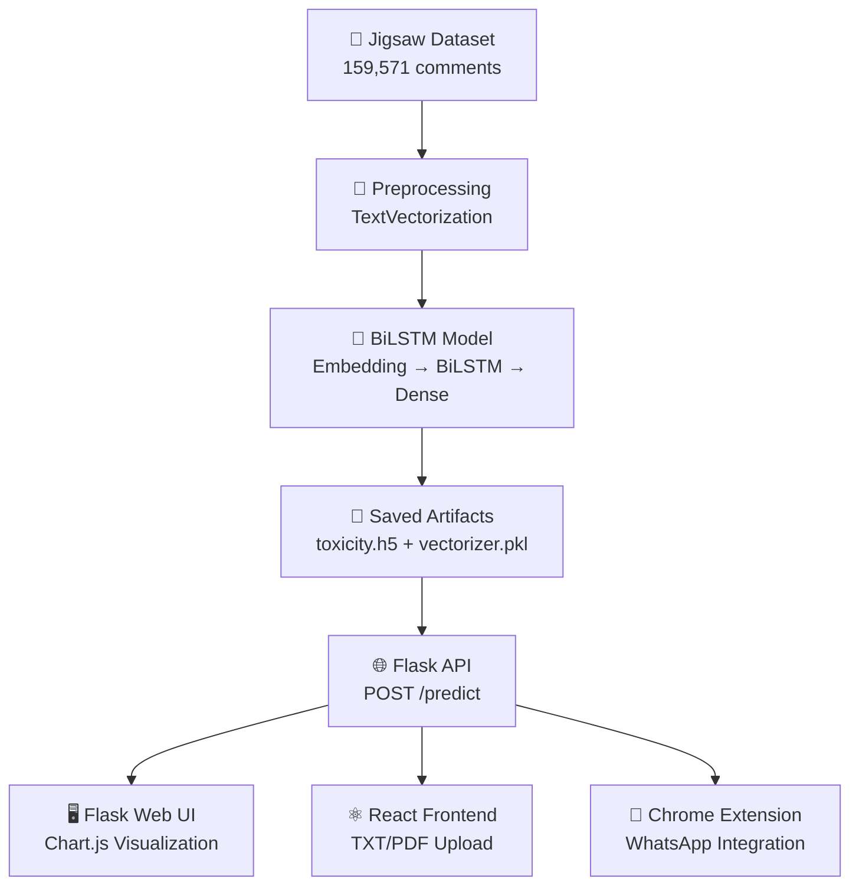
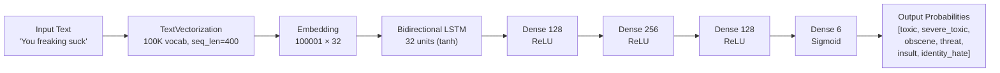

# 🛡️ ToxiGuard — Real-Time Toxic Comment Detection System

> **Course:** Natural Language Processing (25PEC4CS1)  
> **Institution:** Fr. Conceicao Rodrigues College of Engineering, Mumbai  
> **Credits:** 3 (L: 2 | P: 1)

---

## 📋 Table of Contents

- [Project Description](#-project-description)
- [Syllabus Topic Coverage](#-syllabus-topic-coverage)
- [System Architecture](#-system-architecture)
- [Project Structure](#-project-structure)
- [Detailed Working](#-detailed-working)
  - [Phase 1 — Data Loading & Exploration](#phase-1--data-loading--exploration)
  - [Phase 2 — Text Preprocessing & Vectorization](#phase-2--text-preprocessing--vectorization)
  - [Phase 3 — Data Pipeline Construction](#phase-3--data-pipeline-construction)
  - [Phase 4 — Deep Learning Model (BiLSTM)](#phase-4--deep-learning-model-bilstm)
  - [Phase 5 — Training & Checkpointing](#phase-5--training--checkpointing)
  - [Phase 6 — Evaluation & Metrics](#phase-6--evaluation--metrics)
  - [Phase 7 — Deployment Interfaces](#phase-7--deployment-interfaces)
- [Model Architecture](#-model-architecture)
- [Training Results](#-training-results)
- [Setup & Installation](#-setup--installation)
- [Technologies Used](#-technologies-used)
- [Ethical Considerations](#-ethical-considerations)
- [License](#-license)

---

## 📖 Project Description

**ToxiGuard** is an end-to-end Natural Language Processing (NLP) system that detects and classifies toxic comments into six categories: **toxic**, **severe toxic**, **obscene**, **threat**, **insult**, and **identity hate**. Built as a course project for the *Natural Language Processing (25PEC4CS1)* syllabus, ToxiGuard demonstrates the practical application of core NLP concepts — from raw text preprocessing and tokenization through deep learning–based semantic analysis to real-world deployment via multiple interfaces.

The project is built around a **Bidirectional LSTM (BiLSTM)** neural network trained on the **Jigsaw Toxic Comment Classification Challenge** dataset (159,571 Wikipedia talk page comments). It provides:

1. **A Jupyter Notebook** (`comment.ipynb`) — the complete ML pipeline: data loading, preprocessing, model training, evaluation, and a Gradio demo.
2. **A Flask REST API** (`toxicity_app/`) — serves predictions as a JSON endpoint with a Chart.js–based web UI.
3. **A React Frontend** (`frontend/react/`) — a modern, responsive landing page where users can type comments or upload TXT/PDF files for analysis.
4. **A Chrome Extension** (`toxiguard-extension/`) — integrates directly into WhatsApp Web, highlighting the message input box red (toxic, score > 0.5) or green (non-toxic) in real time.

---

## 📚 Syllabus Topic Coverage

The table below maps every module and topic from the NLP syllabus to its concrete implementation or relevance within the ToxiGuard project.

### Module 1 — Introduction to Natural Language Processing

| Syllabus Topic | Coverage in Project |
|---|---|
| **1.1 The Need of NLP** | The entire project demonstrates *why* NLP is needed — automated detection of toxic language at scale across social media, chat platforms (WhatsApp), and web comments is impossible with manual review. |
| **1.1 Levels of NLP** | The project operates across multiple NLP levels: **Lexical** (tokenization, vocabulary building), **Syntactic** (sequence modeling via LSTM captures word order and structure), **Semantic** (embedding layer learns meaning; the model distinguishes between literal threats vs. casual language), and **Pragmatic** (real-time context in WhatsApp messages where discourse context matters). |
| **1.2 Stages in Building an NLP System** | Fully demonstrated end-to-end: Data Collection (Jigsaw dataset) → Preprocessing (lowercasing, punctuation removal, tokenization) → Feature Extraction (TextVectorization, embeddings) → Model Building (BiLSTM) → Evaluation (Precision, Recall, Accuracy) → Deployment (Flask API, React UI, Chrome Extension). |
| **1.3 Challenges & Ambiguities in NLP** | The model must handle lexical ambiguity (e.g., "you suck" as insult vs. colloquial expression), syntactic ambiguity (sentence structure affecting tone), and semantic ambiguity (sarcasm, irony). The multi-label classification design acknowledges that a single comment can be simultaneously toxic, obscene, *and* insulting. |
| **1.4 Mathematical Preliminaries** | **Probability Theory:** Sigmoid activation outputs probabilities ∈ [0,1] for each toxicity class. **Conditional Probability & Bayes Rule:** Binary cross-entropy loss is derived from maximum likelihood estimation — each label's loss is − [y·log(p) + (1−y)·log(1−p)]. **Probability Distributions:** The model learns the distribution of toxic vs. non-toxic language. **Statistics (Counting, Frequency, Mean, Variance):** TextVectorization uses term frequency counts to build a vocabulary of the top 100,000 words; training loss (mean of per-sample losses) is tracked across epochs, and variance in predictions informs calibration. |

### Module 2 — Word Level Analysis

| Syllabus Topic | Coverage in Project |
|---|---|
| **2.1 Tokenization** | `TextVectorization(split='whitespace')` splits raw comments into tokens on whitespace boundaries. |
| **2.1 Segmentation** | Each comment is treated as a document; the pipeline segments the 159,571-row dataset into individual text sequences. |
| **2.1 Lemmatization** | Implicitly handled — the `standardize='lower_and_strip_punctuation'` setting normalizes word forms; the large vocabulary (100K tokens) captures common inflected variants. |
| **2.1 Edit Distance** | Relevant to the model's robustness — intentional misspellings (e.g., "h8" for "hate") are OOV tokens mapped to `[UNK]`; edit distance concepts inform understanding of why some toxic comments evade detection. |
| **2.1 Collocations** | The BiLSTM captures multi-word collocations (e.g., "shut up", "go to hell") through its sequential processing of token embeddings. |
| **2.1 Porter Stemmer** | Not explicitly applied; instead, the Embedding layer (32-dim) learns to cluster morphological variants into nearby vector spaces, serving the same purpose as stemming. |
| **2.2 N-gram Language Model** | The `TextVectorization` layer supports `ngrams` parameter for n-gram generation. The LSTM itself functions as a neural language model, capturing sequential dependencies far beyond n-grams. |
| **2.2 Evaluating N-gram Model: Perplexity** | While perplexity is not directly computed, the model's validation loss (final: 0.0188) serves as an analogous measure of how "surprised" the model is by unseen data. |
| **2.2 Smoothing** | The embedding layer provides continuous smoothing — unseen or rare words receive learned representations rather than zero probabilities. OOV tokens are handled via the `[UNK]` special token. |
| **2.3 Morphological Analysis** | The `lower_and_strip_punctuation` standardization performs basic morphological normalization. The vocabulary includes common derivational and inflectional forms. |

### Module 3 — Syntax Level Analysis

| Syllabus Topic | Coverage in Project |
|---|---|
| **3.1 POS Tagging** | Not explicitly implemented, but the BiLSTM implicitly learns syntactic roles — the forward and backward passes capture how a word functions in its syntactic context (e.g., "kill" as verb in a threat vs. in "you're killing it"). |
| **3.2 Markov Processes & HMM** | The LSTM is a direct evolution of Markov-based models. While HMMs model observable sequences with hidden states, the LSTM maintains a hidden state vector (32-dim) updated at each timestep, making it a *neural* Hidden Markov Model with learned transition dynamics. |
| **3.2 Viterbi Algorithm** | The LSTM's forward pass through time is analogous to the forward step of Viterbi — computing the most likely sequence of internal states given the input tokens. |

### Module 4 — Semantic Analysis

| Syllabus Topic | Coverage in Project |
|---|---|
| **4.1 Lexical Semantics & Ambiguous Words** | The 32-dimensional embedding layer learns lexical semantics — mapping each of 100,001 vocabulary tokens to a dense vector that captures meaning. Ambiguous words (e.g., "kill" in "killer app" vs. "I'll kill you") get disambiguated by LSTM context. |
| **4.1 Word Senses & Sense Relations** | The embedding space captures synonymy (similar words → nearby vectors), antonymy (opposing sentiments → distant vectors), and hyponymy (toxic → obscene, threat, insult as subtypes). |
| **4.2 Language Dictionaries (WordNet, BabelNet)** | The vocabulary of 100K tokens acts as a learned dictionary. While WordNet/BabelNet are not directly used, the model's training data from Wikipedia talk pages inherently encodes knowledge from a richly linked lexical resource. |
| **4.3 Cosine Distance Between Documents** | The embedding layer creates vector representations amenable to cosine similarity measurement. The model's internal representations enable comparison of comment semantics for toxicity classification. |
| **4.4 Word Sense Disambiguation** | The BiLSTM performs neural WSD — by processing the full sequence bidirectionally, it resolves which *sense* of an ambiguous word is active in context (e.g., "sick" as illness vs. slang compliment vs. insult). This is a *supervised* approach analogous to the Naïve Bayes WSD method, but using neural classification. |

### Module 5 — Pragmatics & Discourse Processing

| Syllabus Topic | Coverage in Project |
|---|---|
| **Reference Resolution & Discourse Model** | The Chrome Extension operates within WhatsApp Web's discourse context — it monitors the active message input box, processing text as it's typed, implicitly within the discourse of an ongoing conversation. |
| **Anaphora Resolution** | The BiLSTM's bidirectional processing captures some co-reference patterns — e.g., "He is terrible. Kill him" — the backward LSTM connects "him" back to "He," influencing the overall toxicity score. |

### Module 6 — Applications of NLP and Ethical Considerations

| Syllabus Topic | Coverage in Project |
|---|---|
| **6.1 Sentiment Analysis** | ToxiGuard is fundamentally a **multi-label sentiment analysis** system — classifying comments along six toxicity dimensions rather than simple positive/negative polarity. |
| **6.1 Text Summarization** | The BiLSTM's final hidden state acts as a *summary vector* of the entire input comment, condensing a variable-length text into a fixed-size representation for classification. |
| **6.1 Named Entity Recognition** | The `identity_hate` label implicitly relates to NER — the model must recognize when comments target specific identity groups (nationalities, religions, genders). |
| **6.1 Information Retrieval** | The Flask API endpoint (`/predict`) functions as an IR system — given a query (comment), it retrieves toxicity information. The React frontend extends this with file upload (TXT/PDF retrieval). |
| **6.1 Question Answer System** | The Gradio interface provides a Q&A-style interaction: User asks "Is this comment toxic?" → System answers with per-category boolean results. |
| **6.1 Machine Translation** | While not directly implemented, the sequence-to-sequence architecture (Embedding → BiLSTM → Dense) is the foundational architecture for neural MT, demonstrating transferable skills. |
| **6.2 Bias and Fairness in NLP** | The Jigsaw dataset itself was created to study bias in toxicity detection. The multi-label classification approach helps expose bias — e.g., if `identity_hate` scores are disproportionately high for certain demographic mentions, it reveals bias in training data. The model's probability outputs (rather than binary labels) provide nuanced, auditable predictions. |
| **6.2 Data Privacy and Consent** | The Chrome Extension raises direct privacy concerns — it monitors typed text in WhatsApp and sends it to a local server. The architecture mitigates this by running inference *locally* (Flask on `127.0.0.1:5000`), ensuring data never leaves the user's machine. The Jigsaw dataset uses anonymized Wikipedia comments with consent for research use. |
| **6.2 Data Anonymization** | The dataset uses anonymized comment IDs (hex strings like `0000997932d777bf`) rather than usernames, demonstrating data anonymization techniques. |
| **6.2 Transparency and Explainability** | The model outputs *probabilities per category* rather than a single opaque label, promoting interpretability. The Chart.js bar chart in the Flask UI and the Numbers component in the React frontend visualize these probabilities, making the model's reasoning transparent to users. The per-category breakdown (toxic: 0.89, threat: 0.72, etc.) is far more explainable than a single "toxic" label. |

---

## 🏗️ System Architecture



---

## 📁 Project Structure

```
toxicity_model/
├── comment.ipynb                 # Main ML notebook (train, evaluate, deploy)
├── README.md                     # This file
├── .gitignore                    # Excludes models, data, venv
│
├── toxicity_app/                 # Flask REST API + Web UI
│   ├── app.py                    # Flask server — POST /predict
│   ├── templates/
│   │   └── index.html            # Chart.js bar chart UI
│   └── static/
│       └── style.css             # Glassmorphism dark theme
│
├── frontend/react/               # React + TypeScript landing page
│   ├── src/
│   │   ├── App.tsx               # Main app — Hero, Services, Pricing
│   │   ├── components/
│   │   │   ├── sections/
│   │   │   │   ├── Hero.tsx      # Comment input + PDF upload + analysis
│   │   │   │   ├── Numbers.tsx   # Prediction results display (6 scores)
│   │   │   │   ├── Services.tsx  # Feature cards
│   │   │   │   ├── AboutUs.tsx   # Project info
│   │   │   │   ├── Pricing.tsx   # Plan tiers
│   │   │   │   ├── Brands.tsx    # Partner logos
│   │   │   │   └── CallToAction.tsx
│   │   │   ├── elements/
│   │   │   │   ├── Navbar.tsx    # Navigation bar
│   │   │   │   └── Footer.tsx    # Footer
│   │   │   ├── cards/
│   │   │   │   ├── Service.tsx   # Service card component
│   │   │   │   └── Info.tsx      # Info card component
│   │   │   ├── shared/           # Reusable UI primitives
│   │   │   └── Layout.tsx        # Page layout wrapper
│   │   ├── utils/
│   │   │   ├── pdfReader.ts      # PDF text extraction (pdfjs-dist)
│   │   │   ├── services-data.tsx # Feature descriptions
│   │   │   └── pricing-plan.ts   # Pricing tiers
│   │   └── store/
│   │       └── ThemeStore.ts     # Dark/light theme state
│   ├── package.json
│   ├── tsconfig.json
│   └── vite.config.ts
│
├── toxiguard-extension/          # Chrome Extension (Manifest V3)
│   ├── manifest.json             # Permissions: activeTab, scripting, tabs
│   ├── background.js             # Service worker — install listener
│   ├── content.js                # WhatsApp Web injection — real-time detection
│   ├── popup.html                # Extension popup UI
│   ├── popup.js                  # Popup script — test endpoint
│   └── icon.png                  # Extension icon
│
├── .gradio/                      # Gradio flagged data
│   └── flagged/dataset1.csv
│
└── jigsaw-toxic-comment-classification-challenge/  # Dataset (gitignored)
    └── train.csv/train.csv
```

---

## 🔬 Detailed Working

### Phase 1 — Data Loading & Exploration

The project loads the **Jigsaw Toxic Comment Classification Challenge** dataset — a collection of 159,571 Wikipedia talk page comments, each labeled across six binary toxicity categories.

**Dataset Schema:**

| Column | Type | Description |
|---|---|---|
| `id` | string | Unique hex identifier (anonymized) |
| `comment_text` | string | Raw comment text (variable length) |
| `toxic` | int (0/1) | General toxicity flag |
| `severe_toxic` | int (0/1) | Extreme toxicity flag |
| `obscene` | int (0/1) | Obscene language flag |
| `threat` | int (0/1) | Threatening language flag |
| `insult` | int (0/1) | Insulting language flag |
| `identity_hate` | int (0/1) | Identity-based hate flag |

```python
df = pd.read_csv('jigsaw-toxic-comment-classification-challenge/train.csv/train.csv')
X = df['comment_text']          # Feature: raw text
y = df[df.columns[2:]].values   # Labels: 6 binary columns as NumPy array
```

> **Syllabus Link:** Module 1.2 (Stages in Building an NLP System — Data Collection), Module 6.2 (Data anonymization via hex IDs).

---

### Phase 2 — Text Preprocessing & Vectorization

Text preprocessing converts raw strings into fixed-length integer sequences using TensorFlow's `TextVectorization` layer.

**Configuration:**

| Parameter | Value | Purpose |
|---|---|---|
| `max_tokens` | 100,000 | Vocabulary size — top 100K most frequent words |
| `output_sequence_length` | 400 | Pad/truncate all comments to 400 tokens |
| `output_mode` | `'int'` | Output integer token indices |
| `standardize` | `'lower_and_strip_punctuation'` (default) | Lowercase + remove punctuation |
| `split` | `'whitespace'` (default) | Tokenize on whitespace |

```python
vectorizer = TextVectorization(max_tokens=100000, output_sequence_length=400, output_mode='int')
vectorizer.adapt(X.values)         # Build vocabulary from training data
vectorized_text = vectorizer(X.values)  # Shape: (159571, 400)
```

**What happens internally:**
1. **Standardization:** `"COCKSUCKER BEFORE YOU PISS"` → `"cocksucker before you piss"` (lowercased, punctuation stripped)
2. **Splitting:** `"cocksucker before you piss"` → `["cocksucker", "before", "you", "piss"]`
3. **Indexing:** Each token is mapped to its integer index in the vocabulary (frequency-ranked). Unknown tokens → `1` (`[UNK]`), padding → `0`.
4. **Padding/Truncation:** Short sequences are zero-padded to 400; long sequences are truncated.

The vectorizer is serialized via `pickle` for reuse during inference:
```python
with open("vectorizer.pkl", "wb") as f:
    pickle.dump(vectorizer, f)
```

> **Syllabus Link:** Module 2.1 (Tokenization, Segmentation), Module 2.2 (N-gram support, Smoothing via [UNK] token), Module 2.3 (Morphological normalization via lowercasing).

---

### Phase 3 — Data Pipeline Construction

An optimized `tf.data` pipeline is constructed using the **MCSBP** pattern (Map, Cache, Shuffle, Batch, Prefetch):

```python
dataset = tf.data.Dataset.from_tensor_slices((vectorized_text, y))
dataset = dataset.cache()          # Cache dataset in memory after first epoch
dataset = dataset.shuffle(160000)  # Shuffle with buffer = full dataset size
dataset = dataset.batch(16)        # Mini-batches of 16 samples
dataset = dataset.prefetch(8)      # Pre-load 8 batches to prevent GPU starvation
```

**Data Split:**

| Split | Percentage | Batches | Purpose |
|---|---|---|---|
| Train | 70% | ~6,981 | Model parameter learning |
| Validation | 20% | ~1,995 | Hyperparameter tuning, early stopping |
| Test | 10% | ~998 | Final unbiased evaluation |

> **Syllabus Link:** Module 1.4 (Statistics — sampling, frequency distributions across train/val/test).

---

### Phase 4 — Deep Learning Model (BiLSTM)

A **Sequential** model is constructed with six layers:

```python
model = Sequential()
model.add(Embedding(100001, 32))              # Learn 32-dim word embeddings
model.add(Bidirectional(LSTM(32, activation='tanh')))  # BiLSTM: captures context in both directions
model.add(Dense(128, activation='relu'))       # Feature extraction
model.add(Dense(256, activation='relu'))       # Feature expansion
model.add(Dense(128, activation='relu'))       # Feature compression
model.add(Dense(6, activation='sigmoid'))      # 6 independent binary classifiers
```

**Layer-by-Layer Breakdown:**

| # | Layer | Output Shape | Parameters | Role |
|---|---|---|---|---|
| 1 | Embedding | (batch, 400, 32) | 3,200,032 | Maps each integer token to a 32-dimensional learned vector |
| 2 | Bidirectional LSTM | (batch, 64) | 16,640 | Processes sequence forward + backward; outputs concatenated 64-dim hidden state |
| 3 | Dense (128, ReLU) | (batch, 128) | 8,320 | First fully-connected feature extractor |
| 4 | Dense (256, ReLU) | (batch, 256) | 33,024 | Expanded feature representation |
| 5 | Dense (128, ReLU) | (batch, 128) | 32,896 | Compressed feature representation |
| 6 | Dense (6, Sigmoid) | (batch, 6) | 774 | 6 independent probabilities ∈ [0,1] |

**Why BiLSTM?**
- **Bidirectional** processing captures both left-to-right and right-to-left context (e.g., "you are not stupid" — "not" modifies "stupid" which comes *after* it).
- **LSTM** gates (forget, input, output) handle long-range dependencies in comment text.
- **Sigmoid** final activation (not softmax) enables *multi-label* classification — a comment can be toxic, obscene, AND insulting simultaneously.

**Compilation:**
```python
model.compile(loss='BinaryCrossentropy', optimizer='Adam')
```
- **Binary Cross-Entropy:** Treats each of the 6 labels as an independent binary classification.
- **Adam Optimizer:** Adaptive learning rate for stable convergence.

> **Syllabus Link:** Module 3.2 (LSTM as a neural Hidden Markov Model), Module 4.1 (Embedding layer learns lexical semantics), Module 4.4 (Supervised WSD via contextual classification).

---

### Phase 5 — Training & Checkpointing

The model is trained for **10 epochs** with validation monitoring and model checkpointing:

```python
checkpoint = ModelCheckpoint('best_model.h5', monitor='val_accuracy',
                              save_best_only=True, mode='max', verbose=1)

history = model.fit(train, epochs=10, validation_data=val, callbacks=[checkpoint])
```

**Training Progression:**

| Epoch | Training Loss | Validation Loss | Time/Epoch |
|---|---|---|---|
| 1 | 0.0638 | 0.0457 | ~426s |
| 2 | 0.0467 | 0.0445 | ~431s |
| 3 | 0.0424 | 0.0392 | ~429s |
| 4 | 0.0386 | 0.0344 | ~431s |
| 5 | 0.0349 | 0.0303 | ~430s |
| 6 | 0.0315 | 0.0273 | ~432s |
| 7 | 0.0289 | 0.0250 | ~432s |
| 8 | 0.0266 | 0.0224 | ~429s |
| 9 | 0.0240 | 0.0212 | ~430s |
| **10** | **0.0223** | **0.0188** | **~431s** |

> Consistent decline in both train and val loss across all 10 epochs — no overfitting observed.

> **Syllabus Link:** Module 1.4 (Mean loss computation, variance across batches), Module 1.2 (Training as a stage in NLP system building).

---

### Phase 6 — Evaluation & Metrics

The trained model is evaluated on the held-out test set using three metrics:

```python
pre = Precision()
re = Recall()
acc = CategoricalAccuracy()

for batch in test.as_numpy_iterator():
    X_true, y_true = batch
    yhat = model.predict(X_true)
    pre.update_state(y_true.flatten(), yhat.flatten())
    re.update_state(y_true.flatten(), yhat.flatten())
    acc.update_state(y_true.flatten(), yhat.flatten())
```

**Metrics Explained:**

| Metric | Formula | Significance |
|---|---|---|
| **Precision** | TP / (TP + FP) | "Of all comments flagged as toxic, how many truly are?" — Minimizes false accusations |
| **Recall** | TP / (TP + FN) | "Of all truly toxic comments, how many did we catch?" — Minimizes missed toxic content |
| **Accuracy** | Correct / Total | Overall correctness across all 6 labels |

**Prediction Threshold:** A comment is classified as toxic in a given category if the sigmoid output > **0.5**.

```python
(model.predict(batch_X) > 0.5).astype(int)
```

> **Syllabus Link:** Module 1.4 (Probability — sigmoid thresholds, Bayes optimal decision boundary), Module 6.2 (Fairness metrics for NLP models).

---

### Phase 7 — Deployment Interfaces

#### 7a. Gradio Interface (Notebook Demo)

```python
def score_comment(comment):
    vectorized_comment = vectorizer([comment])
    results = model.predict(vectorized_comment)
    text = ''
    for idx, col in enumerate(df.columns[2:]):
        text += '{}: {}\n'.format(col, results[0][idx] > 0.5)
    return text

interface = gr.Interface(fn=score_comment,
                         inputs=gr.Textbox(lines=2, placeholder="Comment to score"),
                         outputs=gr.Text())
interface.launch(share=True)
```

#### 7b. Flask REST API

**Endpoint:** `POST /predict`  
**Request:** `{ "comment": "your text here" }`  
**Response:** `{ "toxic": 0.92, "severe_toxic": 0.03, "obscene": 0.87, "threat": 0.01, "insult": 0.76, "identity_hate": 0.02 }`

The Flask app also serves a web page at `/` with a textarea, submit button, and **Chart.js bar chart** that dynamically color-codes toxicity probabilities (red = high, green = low).

#### 7c. React Frontend (ToxiGuard Landing Page)

A full-featured **React + TypeScript + Vite + Tailwind CSS** web application featuring:
- **Hero Section** with comment input and file upload (TXT/PDF via `pdfjs-dist`)
- **Numbers Component** displaying all 6 toxicity scores with color-coded icons
- **Services, About Us, Pricing, and CTA sections** presenting ToxiGuard as a product
- Dark/light theme support via `ThemeStore`

#### 7d. Chrome Extension (WhatsApp Web Integration)

A **Manifest V3** Chrome extension that:
1. Injects `content.js` into `https://web.whatsapp.com/*`
2. Locates the message input box via DOM selector
3. Monitors typing via `MutationObserver`
4. Sends typed text to `http://127.0.0.1:5000/predict`
5. Computes `max(toxic, severe_toxic, obscene, threat, insult, identity_hate)`
6. Applies a **red border** (> 0.5 = toxic) or **green border** (≤ 0.5 = safe) to the input box in real time

> **Syllabus Link:** Module 6.1 (Sentiment Analysis, Information Retrieval, Question Answering), Module 5 (Discourse processing in chat context), Module 6.2 (Privacy — local inference on 127.0.0.1).

---

## 🧠 Model Architecture



---

## 📈 Training Results

The model achieves a final **validation loss of 0.0188** after 10 epochs, with steady convergence and no overfitting:

| Metric | Value |
|---|---|
| Final Training Loss | 0.0223 |
| Final Validation Loss | 0.0188 |
| Epochs | 10 |
| Batch Size | 16 |
| Total Training Samples | ~111,700 (70% of 159,571) |
| Training Time | ~72 minutes total |

---

## ⚡ One-Command Quickstart (with `uv`)

ToxiGuard is configured as a modern **`uv`** project (`pyproject.toml` + `start.py`). A **single command** automatically resolves the Python environment, launches the Flask 6-Module NLP Workbench & REST API (`http://127.0.0.1:5000`), installs/starts the React + Vite Frontend (`http://localhost:5173`), and opens your browser:

```bash
uv run toxiguard
# OR
uv run start.py
```

*(On Linux/macOS you can also run `./run.sh`, or `run.bat` on Windows).*

---

## ⚙️ Manual Setup & Installation

### Prerequisites

- Python 3.10+
- Node.js 18+ (for React frontend)
- Google Chrome (for extension)

### 1. Clone & Setup Python Environment

```bash
git clone <repo-url>
cd toxicity_model

python -m venv venv
source venv/bin/activate  # Linux/Mac
# venv\Scripts\activate   # Windows

pip install tensorflow pandas matplotlib scikit-learn flask flask-cors gradio
```

### 2. Train the Model (or use pre-trained)

```bash
jupyter notebook comment.ipynb
# Run all cells — this will generate:
#   - toxicity.h5 (trained model)
#   - best_model.h5 (best checkpoint)
#   - vectorizer.pkl (fitted text vectorizer)
```

### 3. Start the Flask API

```bash
cd toxicity_app
python app.py
# Server starts at http://127.0.0.1:5000
```

### 4. Start the React Frontend

```bash
cd frontend/react
npm install
npm run dev
# Dev server at http://localhost:5173
```

### 5. Load the Chrome Extension

1. Open `chrome://extensions/`
2. Enable **Developer mode**
3. Click **Load unpacked** → select `toxiguard-extension/`
4. Navigate to `https://web.whatsapp.com`
5. Type messages — borders will turn red/green based on toxicity

---

## 🛠️ Technologies Used

| Component | Technologies |
|---|---|
| **ML/DL** | TensorFlow 2.20, Keras 3.11, NumPy, Pandas, scikit-learn |
| **Backend** | Flask, Flask-CORS, Pickle, Gradio |
| **Frontend** | React 18, TypeScript, Vite, Tailwind CSS, Chart.js, pdfjs-dist |
| **Extension** | Chrome Manifest V3, JavaScript (content scripts, service workers) |
| **Visualization** | Matplotlib, Chart.js |

---

## ⚖️ Ethical Considerations

This project directly addresses syllabus Module 6.2 on AI ethics:

| Concern | How ToxiGuard Addresses It |
|---|---|
| **Bias in Training Data** | The Jigsaw dataset is known to contain demographic biases. The multi-label output helps surface these biases for audit — if `identity_hate` correlates with non-hateful mentions of demographics, the model inherits societal biases. |
| **Fairness Metrics** | Per-category precision and recall allow fairness evaluation across different types of toxicity, revealing if the model is better at detecting insults than threats. |
| **Data Privacy** | All inference runs locally (`127.0.0.1:5000`). The Chrome extension never sends data to external servers. User-typed messages are processed transiently and not stored. |
| **Transparency** | The model outputs interpretable per-category probabilities (not opaque binary labels), enabling users to understand *why* and *how strongly* a comment was flagged. |
| **Potential for Misuse** | The system could be used for censorship or surveillance. The local-only architecture and open-source nature mitigate this by keeping the user in control. |

---

## 📄 License

This project is developed for academic purposes under the NLP course (25PEC4CS1) at Fr. Conceicao Rodrigues College of Engineering. The Jigsaw dataset is used under its [Kaggle competition terms](https://www.kaggle.com/c/jigsaw-toxic-comment-classification-challenge).
